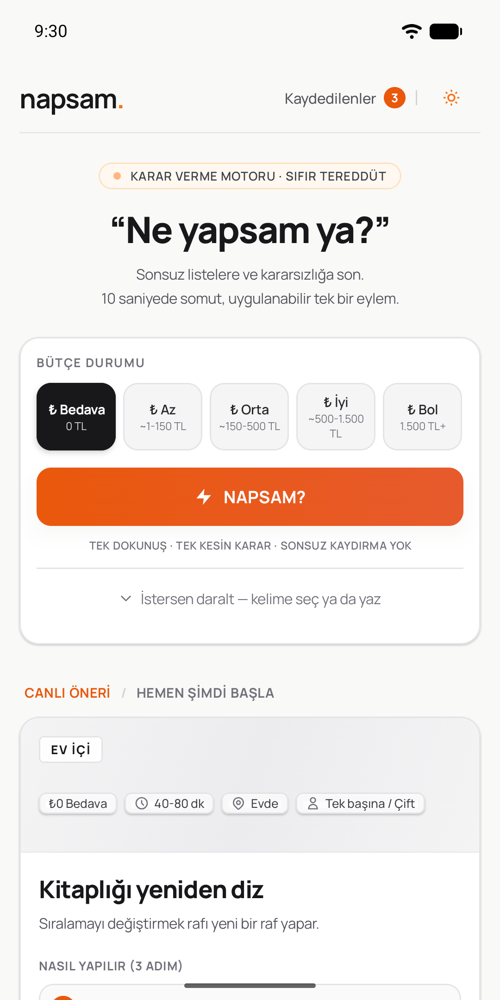
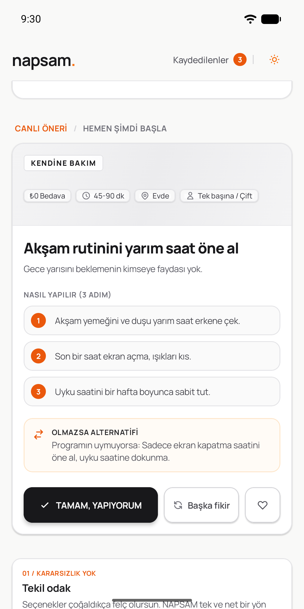
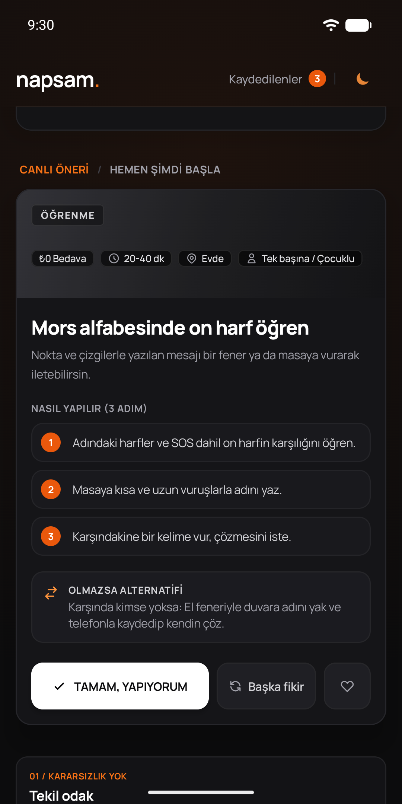
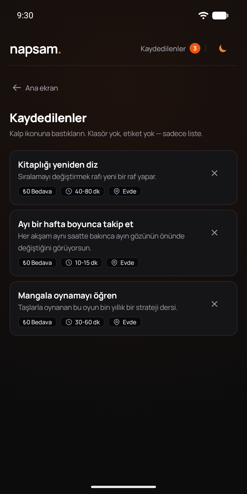
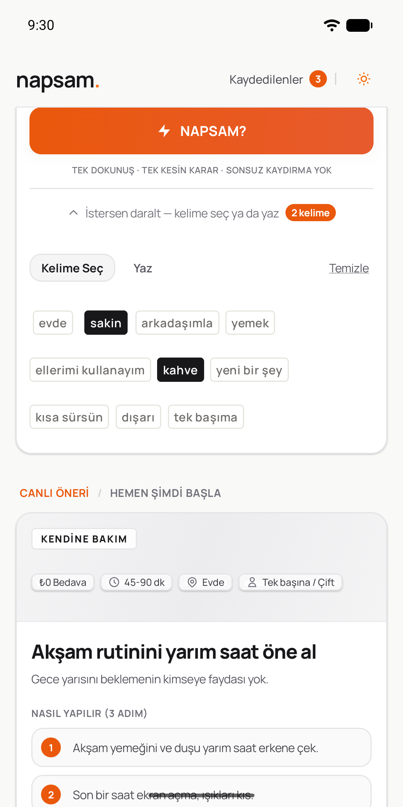
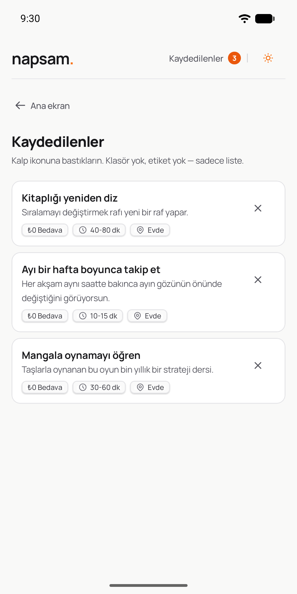
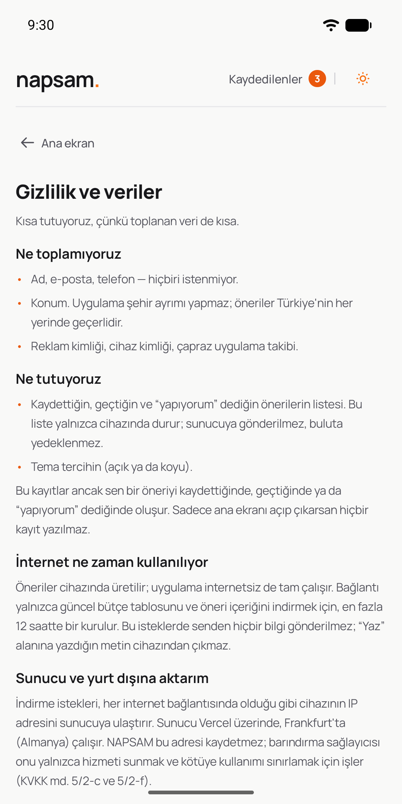
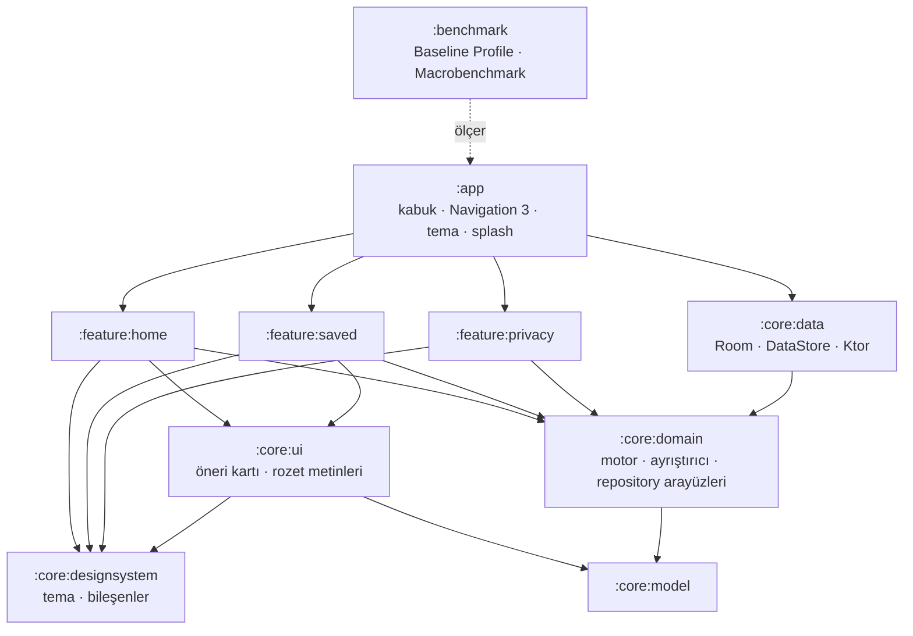

<div align="center">

# napsam.

### “Ne yapsam ya?” diyene tek dokunuşla tek bir somut fikir — Android

Bütçene uyan, **şu an ve bulunduğun yerde** yapabileceğin tek bir eylem.<br>
Sonsuz liste yok, kaydırma yok, kararsızlık yok. İnternet olmadan da çalışır.

[](https://napsam.vercel.app)
[](https://github.com/kaaneneskpc/napsam)


-3DDC84?logo=android&logoColor=white)


</div>

<p align="center">
  
  &nbsp;
  
  &nbsp;
  
  &nbsp;
  
</p>
<p align="center"><sub>Ana ekran · öneri kartı · koyu tema · Kaydedilenler — R8'li sürüm derlemesinden</sub></p>

---

## Fikir

Çoğu uygulama seni ekranda tutmak için tasarlanır. NAPSAM tam tersini hedefler:

> Uygulamayı açarsın, **10 saniyede** fikri alırsın, **uygulamayı kapatırsın** ve o şeyi yaparsın.

Bu repo, [web sürümünün](https://github.com/kaaneneskpc/napsam) Android karşılığıdır. İçerik ve akış web'in
**birebir aynısıdır**; görünüm Stitch'teki son mobil tasarımdan gelir. Web'de olmayan bir özellik Android'e
eklenmez.

## Nasıl çalışır?

1. **Bütçeni seç:** Bedava · Az · Orta · İyi · Bol
2. İstersen **bir kelime seç ya da yaz** (kahve, dışarı, arkadaşımla…). Bu adım tamamen isteğe bağlı.
3. **NAPSAM?** butonuna bas. Karşına tek bir kart çıkar: ne yapacağın, 2-3 adımda nasıl yapacağın ve plan tutmazsa alternatifi.

Beğenmezsen **Başka fikir**, beğenirsen **Kaydet** ya da **Tamam, yapıyorum**. Uygulama açılır açılmaz bir
öneri hazırdır; hiçbir şeye dokunmadan da fikir alırsın.

| Daraltma paneli | Kaydedilenler | Gizlilik |
|---|---|---|
|  |  |  |

## Öne çıkanlar

| | |
|---|---|
| 📴 **İnternetsiz tam çalışır** | 500 öneri uygulamaya gömülü, öneri motoru cihazda çalışır. İnternet yalnızca güncel bütçe tablosunu ve değişen içeriği indirmek için kullanılır. |
| 🪞 **Web ile birebir** | Motor, metin ayrıştırıcı, rozetler ve haftalık tema web'in Python kodundan Kotlin'e taşındı; web'den dışa aktarılan 888 vaka ile test edilir. |
| 🔄 **Güvenli içerik güncellemesi** | Sunucudaki içerik değişince yenisi indirilir. Şema, sayı, tekrar ve bilinmeyen alan denetiminden geçmeyen içerik yazılmaz; geçen içerik tek transaction'da değişir, kayıtların korunur. |
| 🔒 **Gizlilik önce** | Üyelik, kimlik, reklam, analiz ve konum yok. Kayıtlar yalnızca telefonda durur, buluta yedeklenmez. Yazdığın metin cihazdan çıkmaz. |
| ♿ **Erişilebilir** | %200 yazı boyutunda taşmayan düzen, TalkBack etiketleri, 48 dp dokunma alanları. |
| 🌗 **Açık / koyu tema** | Seçim cihazda saklanır; geniş ekranda içerik web'deki gibi 760 dp genişlikte ortalanır. |

## Web ile birebirlik

Android'deki mantık web'den tahminle değil, **sözleşmeyle** taşındı. Web reposundaki `export_mobile` komutu
içeriği ve parite vakalarını [`contract/`](contract/) klasörüne dışa aktarır; testler bu dosyaları okur.

| Dosya | Ne doğrular | Vaka |
|---|---|---|
| `parity/engine.json`, `sample.json`, `candidates.json`, `relax.json` | Öneri motoru: sert filtreler, puanlama, örnekleme, filtre gevşetme | 23 + 13 + 73 + 6 |
| `parity/textmode.json` | "Yaz" modu metin ayrıştırıcısı | 164 cümle |
| `parity/badges.json` | Kart rozetleri (maliyet, süre, mekân, kiminle) | 500 öneri |
| `parity/theme.json` | Haftalık tema rotasyonu | 80 hafta |
| `parity/budget.json`, `chips.json` | Asgari ücrete bağlı bütçe tutarları, saate göre kelime seti | 5 ücret, 24 saat |

"Yaz" ayrıştırıcısı ayrıca **cihazda** da test edilir: Android'in regex motoru (ICU) JVM'den farklıdır ve bu
fark bir kez uygulamayı çökertmişti (`(?U)` bayrağı). JVM testleri bunu göremez.

## Mimari



- **Tek yönlü bağımlılık:** feature modülleri birbirini ve `:core:data`'yı görmez; yalnızca `:core:domain`'deki
  arayüzleri kullanır. Uygulamaları Hilt ile `:app` bağlar.
- **`:core:model` ve `:core:domain` saf Kotlin** (Android bağımlılığı yok, explicit API); motor JVM'de hızlıca
  test edilir.
- **Offline-first:** ilk açılışta gömülü içerik Room'a aktarılır; config 12 saatte bir, içerik yalnızca sürümü
  değiştiğinde indirilir. Ağ hatası hiçbir zaman kullanıcıya yansımaz, her çağrı bir `Outcome` döner.
- **UI:** Jetpack Compose, `StateFlow` + tek `UiState`, Navigation 3 ile üç ekran (Ana ekran, Kaydedilenler,
  Gizlilik); süreç ölümünden sonra ekran ve geri yığını korunur.
- **Derleme mantığı `build-logic/` convention plugin'lerinde:** modül build dosyaları yalnızca eklenti ve
  bağımlılık listeler; sürümler tek bir kataloğda (`gradle/libs.versions.toml`).

## Teknolojiler

| Katman | Seçim |
|---|---|
| Dil ve derleme | Kotlin 2.4.20 (built-in), AGP 9.4.0, Gradle 9.7.1, KSP, JDK 21 |
| Arayüz | Jetpack Compose (BOM 2026.09.00), Navigation 3, Core SplashScreen |
| Veri | Room 2.8.5, DataStore 1.2.1 (kotlinx.serialization ile tipli), Ktor 3.5.2 |
| DI | Hilt 2.60.1 |
| Test | JUnit 4, Robolectric 4.17, Roborazzi 1.74, Turbine, Ktor MockEngine |
| Performans | Baseline + Startup Profile, Macrobenchmark 1.5.0, R8 |
| Kod kalitesi | Spotless + ktlint + Compose kuralları, Android Lint (hata = derleme durur) |
| Hedef | minSdk 26 · targetSdk 37 · yalnızca Türkçe |

## Proje yapısı

```
app/                    uygulama kabuğu: MainActivity, NapsamApp (Navigation 3), tema tercihi, ikon
feature/
  home/                 ana ekran: bütçe, NAPSAM?, daraltma paneli, öneri kartı
  saved/                Kaydedilenler
  privacy/              Gizlilik (KVKK aydınlatma metni)
core/
  model/                veri modelleri (saf Kotlin)
  domain/               öneri motoru, metin ayrıştırıcı, bütçe, haftalık tema, repository arayüzleri
  data/                 Room, DataStore, Ktor istemcisi, içerik içe aktarma ve güncelleme
  designsystem/         renkler, tipografi, bileşenler (Stitch tasarımı)
  ui/                   öneri kartı ve rozet metinleri
benchmark/              Baseline Profile üretimi, açılış ve kaydırma ölçümü
build-logic/            convention plugin'ler
contract/               web'den dışa aktarılan içerik ve parite vakaları
docs/                   plan, CI, sürüm, Play belgeleri, tasarım
```

## Derleme ve çalıştırma

Gereken: JDK 21 ve Android SDK (API 37). Gradle JDK'yı `gradle/gradle-daemon-jvm.properties`'ten seçer.

```bash
git clone https://github.com/kaaneneskpc/napsamandroid.git
```

```bash
./gradlew :app:installDebug
```

Sürüm derlemesi (R8, Baseline Profile dahil). İmza bilgisi yoksa hata ayıklama anahtarıyla imzalanır; gerçek
imzalama için [`docs/RELEASE.md`](docs/RELEASE.md):

```bash
./gradlew :app:assembleRelease
```

Uygulama ek bir yapılandırma ya da gizli anahtar istemez. İstemcide API anahtarı yoktur ve gerekmez.

## Test

Biçim, lint, birim + parite + ekran görüntüsü testleri — CI'daki PR denetimiyle aynı komut:

```bash
./gradlew check verifyRoborazziDebug
```

| Tür | Nerede | Ne yapar |
|---|---|---|
| Birim ve parite (117) | `*/src/test` | Motor, ayrıştırıcı, bütçe, repository'ler ve ViewModel'ler; web vakalarıyla karşılaştırma |
| Ekran görüntüsü (16 golden) | Roborazzi | Açık/koyu tema, %200 yazı, en uzun Türkçe metin; tasarımdan sapma farkı yakalanır |
| Cihaz paritesi | `core/data/src/androidTest` | 164 "Yaz" cümlesi ART + ICU üzerinde |
| Ölçüm | `benchmark/` | Soğuk açılış (profilli / profilsiz), kaydırma kare süreleri |

Cihaz testleri için emülatör ya da telefon bağlıyken:

```bash
./gradlew :core:data:connectedDebugAndroidTest
```

Ekran görüntülerini güncellemek (tasarım bilerek değiştiyse):

```bash
./gradlew recordRoborazziDebug
```

## Performans

Emülatörde (Pixel 9 Pro, API 37), R8'li sürüm, 10 tur medyanı. Ayrıntı ve yöntem: [`benchmark/README.md`](benchmark/README.md).

| Ölçüm | Profilsiz | Baseline Profile ile | Hedef |
|---|---|---|---|
| Soğuk açılış, ilk kare | 209 ms | **158 ms** | < 800 ms |
| Açılış → ilk öneri | 293 ms | **209 ms** | < 1 sn |

Profil yeniden üretmek için (bağlı cihaz gerekir):

```bash
./gradlew :app:generateReleaseBaselineProfile
```

APK boyutu R8 sonrası ~1,9 MB.

## CI

| İş akışı | Ne zaman | Ne yapar |
|---|---|---|
| [`pr.yml`](.github/workflows/pr.yml) | her PR, `main`'e push | biçim, lint, birim + parite + ekran görüntüsü testleri, R8'li sürüm derlemesi |
| [`release.yml`](.github/workflows/release.yml) | `v*` etiketi | yönetilen emülatörde Baseline Profile, imzalı AAB |
| [`screenshots.yml`](.github/workflows/screenshots.yml) | elle | golden ekran görüntülerini Linux'ta yeniden kaydeder |

Action'lar commit SHA'sıyla sabit, izinler salt okunur, PR denetimi hiçbir sır kullanmaz. Ayrıntı:
[`docs/CI.md`](docs/CI.md).

## Gizlilik

- Üyelik, e-posta, telefon, konum, reklam kimliği, cihaz kimliği yok; reklam ve analiz aracı yok.
- Kaydettiğin, geçtiğin ve "yapıyorum" dediğin öneriler ile tema tercihin **yalnızca telefonda** durur; buluta
  yedeklenmez. Silmek için uygulamanın verilerini temizlemek ya da uygulamayı kaldırmak yeter.
- İnternet yalnızca bütçe tablosu ve içerik indirmek içindir; isteklerde senden hiçbir bilgi gitmez.
- Şifresiz trafik kapalı (Network Security Config), sürüm derlemesinde log yok.

KVKK aydınlatma metni uygulamada **Gizlilik** ekranında ve [web'de](https://napsam.vercel.app/gizlilik/)
bulunur. Play Data Safety taslağı: [`docs/play/data-safety.md`](docs/play/data-safety.md).

## Belgeler

| Belge | İçerik |
|---|---|
| [`docs/PLAN.md`](docs/PLAN.md) | Faz faz ne yapıldı, alınan kararlar |
| [`docs/napsam-android-prompt.md`](docs/napsam-android-prompt.md) | Spesifikasyon |
| [`docs/RELEASE.md`](docs/RELEASE.md) | Upload anahtarı, Play App Signing, sürüm kontrol listesi, R8 notları |
| [`docs/CI.md`](docs/CI.md) | İş akışları, sırlar, ilk çalıştırmada bakılacaklar |
| [`docs/play/`](docs/play/) | Mağaza metinleri, içerik formları, Data Safety, görseller |
| [`docs/design/`](docs/design/) | Stitch tasarımı (açık / koyu) |
